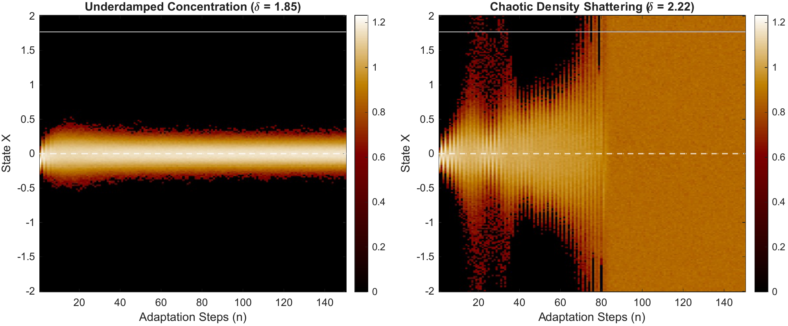
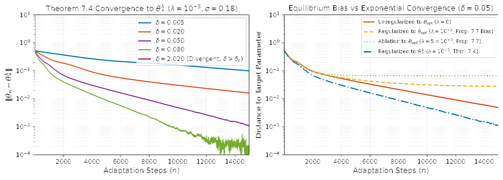
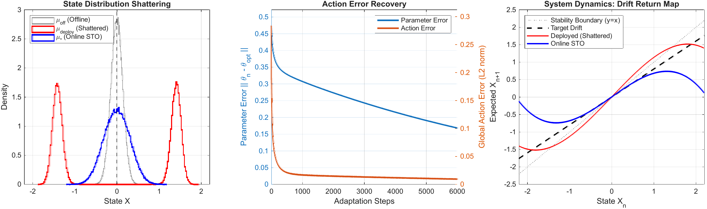

# Autonomous Neural Adaptive Control as a Self-Consistent Transfer Operator
### Numerical Reproduction Suite

[](https://doi.org/10.5281/zenodo.24112629)
[](https://github.com/VittorioFreiburg/sto-adaptive-control/releases/tag/v1.0.0)
[](https://opensource.org/licenses/MIT)
[](https://creativecommons.org/licenses/by/4.0/)
[](https://www.mathworks.com/products/matlab.html)
[](https://www.python.org/)

This repository contains the simulation code, Ulam transfer-operator discretization solvers, precomputed datasets, figure-generation scripts, and LaTeX manuscript sources needed to reproduce every numerical result in Section 8 ("Numerical Experiments") of:

> **Autonomous Neural Adaptive Control as a Self-Consistent Transfer Operator**  
> *Authors:* **Stefano Galatolo** (Dipartimento di Matematica, Università di Pisa) and **Vittorio Lippi** (Calejo Hybrid Intelligence AB)  
> *Submitted to:* *Journal of Nonlinear Science* (2026)

---

## Contents

- [Theoretical overview](#theoretical-overview)
- [Repository structure](#repository-structure)
- [Quick start](#quick-start)
- [Mapping between paper and code](#mapping-between-paper-and-code)
- [Reproducibility notes](#reproducibility-notes)
- [Building the paper](#building-the-paper)
- [Citation](#citation) · [Authors](#authors--maintainers) · [License](#license)

---

## Theoretical overview

When an adaptive neural controller updates its parameters online while interacting with a physical plant, the physical state distribution and the controller parameters form an inextricably coupled dynamical system. Offline calibration breaks down at deployment due to **Action Error**—the failure of invariance caused by feedback-induced distributional shifts.

This codebase implements and validates the **Self-Consistent Transfer Operator (STO)** framework on the **reflected noisy Duffing-type cubic control system** $x_{n+1} = r_2\big(1.05\,x_n + 0.15\,x_n^3 + u_n + \xi_n\big)$ on $X=[-2,2]$:

1. **Barycentric representation & monokinetic reduction**: ambient measures $\mu \in \mathcal{P}_\Theta^1(X \times \Theta)$ factorize through the parameter barycenter $\mathcal{R}(\mu) = \int \theta\, d\mu$, guaranteeing one-step collapse onto the monokinetic manifold $\mathscr{M}_{\rm mono}$ and eliminating spurious multi-controller equilibria.
2. **Equilibrium existence via Brouwer degree**: stationary equilibria $(\mu_{\theta_*},\theta_*)$ correspond bijectively to zeros of the reduced learning field $\overline{G}(\theta_*) = 0$ (Theorem 3.3). Coercivity and Brouwer degree guarantee existence without requiring global convexity (Theorem 3.7).
3. **Linear response & time-scale separation**: under a spectral gap on the frozen physical operator, the reduced Jacobian decomposes into the static feature Gram matrix $H_*$ and the statistical linear-response sensitivity $C_* R_* B_*$ of the invariant measure $\mu_{\theta_*}$ (Proposition 5.5):
   $$D\overline{G}(\theta_*) = H_* + C_* R_* B_* = \mathcal{J}_*, \qquad \lambda_j^{\rm slow}(\delta) = 1 - \delta \lambda_j(\widehat\Gamma \mathcal{J}_*) + o(\delta).$$
   Tikhonov regularization $\lambda\|\theta\|^2/2$ introduces an $O(\lambda)$ equilibrium shift $\theta_*^\lambda = \theta_{\rm opt} - \lambda Q_{\rm opt}^{-1}\theta_{\rm opt} + O(\lambda^2)$ while accelerating slow-manifold convergence (Proposition 7.7).
4. **Identifiability trap vs. persistent excitation**: weak excitation ($\sigma = 0.10$) contracts state variance around the origin, collapsing $\lambda_{\min}(H_*)$ by $28.6\times$ and stalling cubic identification, whereas persistent stochastic excitation ($\sigma = 0.18$) expands the stationary support and restores full parameter identifiability.
5. **Loss of linear stability**: when the learning rate $\delta$ crosses the linear stability threshold $\delta_c \approx 2/\lambda_{\max}(H_*)$ (where the leading slow multiplier crosses $-1$), the coupled system transitions from damped alternating concentration to sustained macroscopic density oscillations across $[-2, 2]$.

### Key findings

| Loss of stability & density dispersion (Figs. 8–9) | Time-scale separation & spectral rates (Fig. 3) | Action-error recovery (Fig. 6) |
| :---: | :---: | :---: |
|  |  |  |

---

## Repository structure

```text
.
├── reproduce_all.m                  # Entry point: regenerates all paper figures (quick / full mode)
│
├── matlab/                          # Experiments (MATLAB R2020b+, base MATLAB only)
│   ├── fast_theorem74_convergence_sto.m          # Time-scale sweep over δ, Prop. 7.7 shift       (§8.2, Fig. 3)
│   ├── persistent_excitation_regularized_sto.m   # Nominal adaptation, weak vs. persistent excitation (§8.2, §8.3.1, Figs. 2, 5)
│   ├── run_revised_section8_experiments.m        # Ulam operator, linear response C*R*B, FD checks, deployment ablation (§8.1–8.3.2, Fig. 4, Table 2)
│   ├── fig_linear_response_contribution.m        # Stand-alone generator of Figure 4 (writes data/data_fig4_linear_response.mat)
│   ├── validate_theoretical_sto.m                # Two-phase deployment & action-error recovery  (§8.3.2, Figs. 6, 7)
│   ├── bifurcation_stability_loss_sto.m          # Large-δ sweep, bifurcation diagram, density dispersion (§8.3.3, Figs. 8, 9)
│   ├── mlp_nonconvex_proof_sto.m                 # Non-convex MLP compensator (p = 25)            (§8.4, Fig. 10)
│   ├── regenerate_all_section8_figures.m         # Renders Figs. 4–9 from the .mat files in data/
│   └── sto_paths.m                               # Helper: absolute paths of data/, figures/, results/
│
├── python/                          # Vector-PDF renderers for Figs. 2, 3, 4 (read data/*.mat)
│   ├── plot_nominal.py                           # Figure 2
│   ├── plot_theorem74.py                         # Figure 3 (+ supplementary diagnostic)
│   └── plot_fig4.py                              # Figure 4
│
├── data/                            # Precomputed datasets (see data/README.md for every variable)
│   ├── data_part1_nominal.mat
│   ├── data_fast_theorem74.mat
│   ├── data_validate_theoretical.mat
│   ├── data_bifurcation_sweep.mat
│   └── data_fig4_linear_response.mat
│
├── figures/                         # The 9 figures of Section 8 exactly as included in the paper
│   └── supplementary/               # Diagnostic figures not used in the paper
├── results/                         # Plain-text metric logs written by the experiment scripts
├── paper/                           # LaTeX sources of the manuscript (main + Section 7 + Section 8)
├── assets/                          # Preview images used in this README
│
├── requirements.txt                 # Python dependencies (NumPy, SciPy, Matplotlib)
├── CITATION.cff                     # Citation metadata (GitHub "Cite this repository")
├── .zenodo.json                     # Zenodo release metadata
└── LICENSE                          # MIT
```

All scripts locate `data/`, `figures/`, and `results/` relative to the repository root, so they can be invoked from any working directory.

---

## Quick start

### Requirements
- **MATLAB** R2020b or later (base MATLAB, no toolboxes required).
- **Python** 3.9+ with `pip install -r requirements.txt` (used by the vector renderers in `python/`; `reproduce_all` falls back gracefully if Python is not on the system path).

### 1. Regenerate all figures from precomputed data
The heavy Monte Carlo runs ($N = 10^5$ particles, up to $4\times10^4$ steps) are stored in `data/`.
From MATLAB, in the repository root:

```matlab
reproduce_all('quick')      % or simply reproduce_all
```

or from a terminal: `matlab -batch "reproduce_all('quick')"`. All nine PDFs of Section 8 are written to `figures/`.

### 2. Recompute everything from scratch (10–20 minutes)
Re-runs every Monte Carlo and Ulam experiment with the fixed seed `rng(42)`, updating `data/`, `results/`, and `figures/`:

```matlab
reproduce_all('full')
```

### 3. Run a single experiment

```matlab
addpath('matlab')
results = run_revised_section8_experiments();   % Ulam operator, linear response, FD checks, Table 2
results = fast_theorem74_convergence_sto();     % Fig. 3 data, Prop. 7.7, results/theorem74_metrics.log
persistent_excitation_regularized_sto           % Figs. 2 and 5 data
validate_theoretical_sto                        % Figs. 6 and 7 data
bifurcation_stability_loss_sto                  % Figs. 8 and 9 data
mlp_nonconvex_proof_sto                         % Fig. 10
```

Python renderers can also be run directly, e.g. `python python/plot_theorem74.py`.

---

## Mapping between paper and code

| Paper section & topic | Experiment script (`matlab/`) | Data (`data/`) | Output |
| :--- | :--- | :--- | :--- |
| **§8.2** Autonomous adaptation, regularization | `persistent_excitation_regularized_sto.m`, renderer `python/plot_nominal.py` | `data_part1_nominal.mat`, `data_fast_theorem74.mat` | `figures/fig_part1_nominal_convergence.pdf` (**Fig. 2**) |
| **§8.1–8.2** Time-scale separation, Prop. 7.7 | `fast_theorem74_convergence_sto.m`, renderer `python/plot_theorem74.py` | `data_fast_theorem74.mat` | `figures/fig_part1_timescale_and_reg.pdf` (**Fig. 3**); `results/theorem74_metrics.log`; `figures/supplementary/fig_diagnostic_loglog_vs_semilogy.pdf` |
| **§8.1, §8.2.1** Ulam operator, linear response $C_*R_*B_*$ | `run_revised_section8_experiments.m`, `fig_linear_response_contribution.m`, renderer `python/plot_fig4.py` | `data_fig4_linear_response.mat` | `figures/fig_linear_response_contribution.pdf` (**Fig. 4**); finite-difference diagnostics printed to the console |
| **§8.3.1** Weak vs. persistent excitation | `persistent_excitation_regularized_sto.m` | `data_part1_nominal.mat` | `figures/fig_part2_identifiability_trap_pe.pdf` (**Fig. 5**); `results/persistent_excitation_metrics.log` |
| **§8.3.2** Deployment mismatch, action-error recovery | `validate_theoretical_sto.m`, `run_revised_section8_experiments.m` | `data_validate_theoretical.mat` | `figures/fig_part2_action_error_recovery.pdf` (**Fig. 6**), `figures/fig_part2_escaping_trap_offline.pdf` (**Fig. 7**), deployment ablation (**Table 2**); `results/validate_theoretical_metrics.log` |
| **§8.3.3** Loss of linear stability | `bifurcation_stability_loss_sto.m` | `data_bifurcation_sweep.mat` | `figures/fig_part2_bifurcation_diagram.pdf` (**Fig. 8**), `figures/fig_part2_density_shattering.pdf` (**Fig. 9**); `figures/supplementary/fig_part2_density_candidates.pdf` |
| **§8.4** Non-convex MLP compensator | `mlp_nonconvex_proof_sto.m` | *(simulated on the fly)* | `figures/fig5_mlp_convergence.pdf` (**Fig. 10**) |

Figures 5–9 (and Fig. 4 when the data file is present) are rendered by `matlab/regenerate_all_section8_figures.m` from the stored datasets; Figs. 2–4 are rendered by the Python scripts. `reproduce_all` runs these renderers last so the PDFs in `figures/` always match the publication figures.

---

## Reproducibility notes

- **Seeds.** All stochastic experiments start from MATLAB's Mersenne Twister with `rng(42)`; initial conditions, ensemble sizes, and parameter vectors are tabulated in §8.5 (Table 3) of the paper.
- **Precomputed datasets.** Particle ensembles are deterministic given the seed, and the stored `.mat` files in `data/` contain the exact numerical trajectories behind the published figures.
- **Figure 2 tail.** In Fig. 2 the curve $\|\theta_n-\theta_*^\lambda\|$ comes from a 25 000-step run (`E_reg_fast` in `data_fast_theorem74.mat`) plotted alongside 40 000-step curves; `python/plot_nominal.py` extends its stationary tail by resampling the last 1 000 stored values (seed 42).
- **Logs.** `results/*.log` are the plain-text metric summaries exported by the experiment scripts.

---

## Building the paper

The LaTeX sources are in `paper/` and automatically load the figures from `../figures/` via `\graphicspath`.

```bash
cd paper
pdflatex main_barycentric_audited.tex && pdflatex main_barycentric_audited.tex
```

`main_barycentric_audited.tex` is the master manuscript; it inputs `duffing_example_section_control_explained.tex` (Section 7), which in turn inputs `Empirical_test.tex` (Section 8).

---

## Citation

If you use this codebase or the theoretical results in your research, please cite:

```bibtex
@article{GalatoloLippi2026STO,
  title   = {Autonomous Neural Adaptive Control as a Self-Consistent Transfer Operator},
  author  = {Galatolo, Stefano and Lippi, Vittorio},
  journal = {Journal of Nonlinear Science},
  note    = {Submitted},
  year    = {2026}
}

@software{GalatoloLippi2026STOCode,
  title     = {Autonomous Neural Adaptive Control as a Self-Consistent Transfer Operator (Numerical Reproduction Suite)},
  author    = {Galatolo, Stefano and Lippi, Vittorio},
  year      = {2026},
  publisher = {Zenodo},
  version   = {1.0.0},
  doi       = {10.5281/zenodo.24112629},
  url       = {https://github.com/VittorioFreiburg/sto-adaptive-control}
}
```

---

## Authors & maintainers

- **Stefano Galatolo** — Dipartimento di Matematica, Università di Pisa (`stefano.galatolo@unipi.it`, [ORCID: 0000-0001-9329-8936](https://orcid.org/0000-0001-9329-8936))
- **Vittorio Lippi** — Calejo Hybrid Intelligence AB (`vittorio.lippi@calejo.ai`, [ORCID: 0000-0001-5520-8974](https://orcid.org/0000-0001-5520-8974))

<details>
<summary><b>AMS MSC (2020) & mathematical summary</b></summary>

- **MSC 2020:** `37A30` / `37C30` (ergodic theory & transfer operators), `37H05` (random dynamical systems), `93C40` (adaptive control), `68T07` (artificial neural networks).
- **Operator framework:** self-consistent transfer operator $\mathcal{L}_\delta(\mu) = (\iota \circ \Phi_\delta \circ \mathcal{R})(\mu)$, barycentric parameter marginal $\mathcal{R}(\mu) = \int \theta\, d\mu$, monokinetic invariant manifold $\mathscr{M}_{\rm mono}$, Perron–Frobenius operator $P_\theta$ on $W^{1,1}(X) \subset L^1(X)$.
- **Core identities:** Brouwer-degree equilibrium existence ($\overline{G}(\theta_*) = 0$); linear-response decomposition $D\overline{G}(\theta_*) = H_* + C_* R_* B_* = \mathcal{J}_*$ with zero-mass resolvent $R_* = (\operatorname{Id} - P_{\theta_*})^{-1}|_{\mathcal{V}(X)}$; slow multiplier perturbation $\lambda_j^{\rm slow}(\delta) = 1 - \delta \lambda_j(\widehat\Gamma \mathcal{J}_*) + o(\delta)$; regularization shift (Prop. 7.7); linear stability threshold $\delta_c \approx 2 / \lambda_{\max}(H_*)$.
- **Closed-loop phenomena:** autonomous online adaptation, two-phase offline-to-online deployment mismatch, discretized action-error residual $\|r_{A,h}\|_{\ell^1} = \|P_{{\rm dep},h}(\theta_{\rm off})\mu_{{\rm off},h} - \mu_{{\rm off},h}\|_{\ell^1}$, weak vs. persistent stochastic excitation, baseline gain matching.
</details>

---

## License

The code in this repository is licensed under the [MIT License](LICENSE).
The manuscript sources in `paper/` and the documentation are licensed under [CC-BY 4.0](https://creativecommons.org/licenses/by/4.0/).
